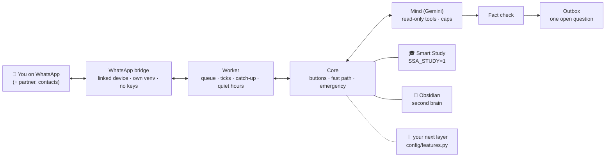

[English](README.md)

<div dir="rtl">

# 📲 העוזר האישי שלך, בוואטסאפ

> **העוזר האישי שלך בוואטסאפ — יומן, תזכורות שרודפות אחריך, משימות ולימודים. רץ על השרת שלך, ושום דבר לא יוצא בלי ✅ שלך.**

**מזכיר אישי שחי בוואטסאפ, על המספר שלך ועל השרת שלך.** הוא מנהל איתך את היומן, התזכורות והמשימות, כותב לאנשים ומזמין בשבילך, וזוכר מה חשוב לך. שום דבר לא יוצא בלי ✅ שלך.

הוא בנוי בשכבות, כדי לגדול איתך: ליבה של מזכיר, ועליה "תחומי חיים". השכבה הראשונה, והמפותחת ביותר, היא **Smart Study** ללימודים באוניברסיטה.

</div>

   

> **English below** · [SETUP.md](SETUP.md) · [Features](docs/FEATURES.md) · [Architecture](docs/ARCHITECTURE.md) · [Costs](docs/COSTS.md) · [FAQ](docs/FAQ.md) · [SECURITY.md](SECURITY.md) · [CLAUDE.md](CLAUDE.md) — open this folder in Claude Code and say "help me set this up": it follows CLAUDE.md and walks you through, without ever touching your keys

<div dir="rtl">

## יום אחד איתו

דוגמה מומצאת, אבל ככה זה נראה:

</div>

```text
07:45  🤖  ☀️ בוקר טוב! היום: 10:00 רופא שיניים, 18:30 אימון.
           📌 פתוח: להחזיר ספרים לספרייה (עד מחר).
           📝 מטלה 4 בהסתברות, הגשה ביום חמישי. עוד לא הוגשה.

09:12  אני  תוסיף ליומן חמישי ב-20 ארוחה אצל ההורים, ותזכיר לי ביום רביעי לקנות פרחים
09:12  🤖  📅 חמישי 20:00–22:00 · ארוחה אצל ההורים
           ⏰ רביעי 18:00 · לקנות פרחים
           [✅ להוסיף]  [✏️ לשנות]

11:30  אני  [כרטיס איש קשר: מלון לדוגמה]  תיצור איתם קשר ותבטל את ההזמנה מחר
11:30  🤖  מה מספר ההזמנה? בלי זה לא אוכל לבטל.
11:31  אני  AB-77
11:31  🤖  זה מה שיישלח למלון לדוגמה:
           "שלום, כאן העוזר האישי של ישראל. נבקש לבטל את הזמנה AB-77 לתאריך מחר. תודה!"
           [✅ לשלוח]  [✏️ לערוך]  [❌ לא]

14:05  🤖  🔔 תזכורת (🚨 חשוב): להתקשר לביטוח עד 15:00
14:20  🤖  🔔 שוב, כי סימנת שזה חשוב.  [✅ ראיתי]  [⏰ עוד שעה]

16:40  🤖  📬 מהאוניברסיטה: התרגול שלך ביום שלישי עובר לחדר 305.
           (2 הודעות על קבוצות אחרות סיננתי.)

21:10  אני  מה מחכה לי?
21:10  🤖  ⏳ 1. מטלה 4 בהסתברות (חמישי)  2. להחזיר ספרים (מחר)
           3. המלון ענה? עוד אין תשובה, אבדוק שוב מחר ב-09:00.
```

<div dir="rtl">

## מה הוא עושה בשבילך: שלוש שכבות

### 1. הליבה: המזכיר (תמיד דולק)

| | |
|---|---|
| 📅 **יומן גוגל** | "תוסיף ליומן…", "תזיז את הפגישה למחר", כמה אירועים בהודעה אחת. התנגשות ביומן מוצגת לפני שאתה מאשר |
| ⚡ **תשובות מיידיות, בלי מודל** | "מה הלוז שלי מחר?", "מה מחכה לי?", "מתי ההגשה הבאה?" נענות מהנתונים בפחות משנייה, ב-‎$0 |
| ⏰ **תזכורות שלא מוותרות** | "תזכיר לי מחר בבוקר…" מובן בקוד (שעון ישראל). מה שסימנת כחשוב ולא ענית: עוד הודעה, ואז התראה ביומן |
| ⏳ **משימות, אישורים, ביטול** | כל מה שפתוח במקום אחד. "ביטלתי את המלון" סוגר את הפריט. ✅ שלא נלחץ מוזכר פעם אחת. "תבטל את מה שעשית" מחזיר את הפעולה האחרונה של הבוט |
| 🤝 **הודעות, תיאומים והזמנות** | "שלח לאמא ש…", כרטיס איש קשר ואז "תיצור איתם קשר", הרשמה באתר בדפדפן אמיתי עד לפני התשלום. הכול אחרי ✅ |
| 📎 **שומר את הקבצים שלך** | PDF, צילום או קישור נשמרים עם סיכום ומזהים, כך ש"מה מספר ההזמנה של המלון?" עובד גם אחרי שבועות |
| 🧳 **חושב קדימה** | נסיעה או תקופה עמוסה ביומן או בהזמנה, ומגיעה תוכנית אחת: מה לסיים ועד מתי, ומה תפספס |
| 🌐 **שאלות מהרשת, בזול** | מזג אוויר, שערים, זמני שבת, חדשות ושעות פתיחה בקוד פייתון, ב-‎$0. שאלה כללית: חיפוש וקריאה, וקריאה קטנה אחת למודל עם מקורות |
| 🔕 **שקט כשצריך** | שאלה פתוחה אחת בכל פעם, שעות שקט, תקרה יומית. "תפסיק לשלוח לי X" משתיק. כשלא היית זמין, הכול מחכה ל"מה פספסתי" אחד. הוא לומד מתי אתה עונה |
| 🛟 **לא נופל** | Gemini למטה או התקציב נגמר: מצב חירום עונה מהנתונים. בדיקת עקביות לילית, התראה מחוץ לוואטסאפ כשהקישור נופל, בדיקת שחזור גיבוי שבועית ודף בריאות |
| 🛠️ **משתפר מעצמו** | 👍/👎 על תשובות וסיכום שבועי. משימה שחוזרת הופכת לכלי פייתון. כל תיקון עובר את כל הבדיקות ומחכה ל-✅ |

### 2. לימודים: Smart Study (`SSA_STUDY=1`)

נבנתה ונבדקה לאורך סמסטר אמיתי באוניברסיטת תל אביב, שנשארת הדוגמה. אוניברסיטה אחרת מוגדרת בקבצי `config/`.

| | |
|---|---|
| ✅ **כל החובות** | כל מטלה ובוחן ממודל לפי קורס: פתוח, הוגש, מבחנים. מטלה שהוזכרה במייל או בהודעה במודל נכנסת למעקב תוך 15 דקות |
| 🪜 **סולם דדליינים** | 7 ימים, 3, יום לפני, בבוקר, 6 שעות ושעתיים לפני, עד שמגישים. אם תרצה, כל דדליין גם ביומן שלך, מתעדכן לבד |
| 📊 **ציונים ומשוב** | ציון והערות הבודק בהודעה אחת. פרופיל חולשות רק כשמבקשים: "על מה אני צריך להתמקד?" |
| 🎯 **סטטיסטיקת מבחנים** | אחוז השאלות לכל נושא ומה חוזר כל שנה, מתוך מבחנים קודמים, בלי מודל |
| 🎥 **סיכומי שיעורים** | ההקלטות של הקבוצה שלך: כתוביות קודם, אחר כך תמלול מקומי בשרת (‎$0), ושירות בתשלום רק בסוף. סיכום בעברית כולל קריאת הלוח, PDF למייל ולוואטסאפ |
| 📓 **NotebookLM קודם** | שאלה על החומר הולכת קודם למחברת של הקורס, שמקבלת לבד את התמלולים והסיכומים |
| 📬 **רק הקבוצה שלך** | מייל ומודל מסוננים לפי היום, השעה והמתרגל שלך. שינויי חדר ושעה נכנסים לכל תשובה על המערכת |
| 🚶 **הליכות בקמפוס** | שני שיעורים צמודים בבניינים רחוקים מקבלים הודעה אחת ביום |

### 3. מוח שני: Obsidian (רשות)

העוזר כותב אזור משלו בכספת: אנשים, מסמכים, מה פתוח, השבוע, יומן יומי ומפות לכל קורס ותחום. החיפוש (BM25 בעברית) עובר על הפתקים שכתבת בעצמך. הפתקים שלך לא נדרסים ולא נמחקים, `rclone copy` בלבד, וטלפונים, מיילים ומזהים מנוקים מכל פתק.

כל יכולת, איך מדליקים אותה וכמה היא עולה: [docs/FEATURES.md](docs/FEATURES.md). המסלול של הודעה ושערי הבטיחות: [docs/ARCHITECTURE.md](docs/ARCHITECTURE.md).

## בנוי בשכבות

ליבה אחת של מזכיר, ותחומי חיים שנדלקים בדגל. כל תחום מביא איתו את הכלים שהמודל רשאי להשתמש בהם, את הבדיקות התקופתיות שלו ואת ההגדרות שלו. תחום כבוי לא נטען בכלל: המודל לא רואה את הכלים שלו, וה-worker לא מריץ את הבדיקות שלו.

</div>



<div dir="rtl">

**להוסיף שכבה משלך:** דגל ב-`config/features.py`, מודול ב-`agent/`, הכלים שלו ב-`TOOLS` של `agent/mind.py` (הם מסוננים ב-`active_tools()`), והבדיקות התקופתיות ב-`tick_list()` של `whatsapp/worker.py`. שכבת הלימודים בנויה בדיוק ככה, אז אפשר להעתיק ממנה.

## כמה זה עולה

עוזר בלבד: בערך ‎$3–10 בחודש. עם הלימודים: בערך ‎$15–30. המספרים נמדדו בהתקנה אמיתית. פירוט ודרכים לחסוך: [docs/COSTS.md](docs/COSTS.md).

| מה | עלות |
|---|---|
| הודעה למוח (Gemini) | ‎$0.005–0.015 (תקרה ‎$0.10 להודעה, ‎$1 ליום) |
| שאלת לוז במסלול המהיר, תזכורות, כפתורים, ביטול, "מה פספסתי" | ‎$0 |
| שאלה מהרשת | ‎$0 מובנית · ‎~$0.0005 כללית · ‎~$0.04 רק כגיבוי |
| שאלה על המערכת עצמה | פחות מ-‎$0.01 (אותה שאלה על אותו commit: ‎$0) |
| סיכום שיעור: כתוביות או תמלול מקומי / שירות תמלול בתשלום | ‎~$0.08 / ‎~$0.40–0.50 |
| הכנה לפני שיעור · בניית האתר בלילה | ‎~$0.001 · עד ‎$0.10 |
| ציונים, סטטיסטיקת מבחנים, כספת, גיבוי, בדיקת עקביות, מצב חירום | ‎$0 |
| שרת Oracle Cloud Always Free | ‎$0 |
| מנוי Gemini אישי במקום חלק מה-API | **כבוי כברירת מחדל**, `SSA_SUBSCRIPTION=1`. הסבר ב-COSTS |

תקרה חודשית קשיחה (ברירת מחדל ‎$50, אפשר לכל חודש בנפרד ב-`config/budget_caps.json`). מעליה כל קריאה בתשלום נעצרת.

## הקמה: שני מסלולים

| | מסלול | מה צריך |
|---|---|---|
| **א׳** | **רק העוזר** (בערך שעה) | מפתח Gemini, מספר וואטסאפ נוסף לבוט (סים/eSIM, מכשיר מקושר) שאתה כותב לו מהמספר שלך, יומן גוגל |
| **ב׳** | **+ Smart Study** (רשות, גם אחר כך) | התחברות לאוניברסיטה, `config/courses.yaml`, מודל ופנופטו, מייל, NotebookLM |

</div>

```bash
python -m venv venv && venv/bin/pip install -r requirements.txt   # Windows: venv\Scripts\pip
python scripts/setup_check.py --init       # .env from the template (SSA_STUDY=0)
python scripts/setup_check.py              # what is still missing on your path
python scripts/install_git_hooks.py        # every push runs the leak scan first
PYTHONIOENCODING=utf-8 python -m tests.test_assistant_only
```

<div dir="rtl">

הכול, צעד אחרי צעד: [SETUP.md](SETUP.md). שאלות נפוצות, טבלת תקלות ומילון משתנים: [docs/FAQ.md](docs/FAQ.md).

## ⚖️ שימוש אחראי

- הפרויקט **לשימוש אישי** ומסופק **כמות שהוא, בלי שום אחריות**. כל מה שתריץ, אתה מריץ על אחריותך.
- **וואטסאפ:** הגשר משתמש בספרייה לא רשמית (מכשיר מקושר). זה עלול לא להתאים לתנאי השימוש של וואטסאפ, והמספר עלול להיחסם. לכן מומלץ מספר נפרד.
- **אוניברסיטה:** השתמש רק בחשבונות שלך, ובדוק שזה מותר לפי הכללים של המוסד שלך. הכלי לא נועד לעקוף גישה, לחלוק חומרי קורס עם מי שאין לו גישה אליהם, או לעשות משהו במקומך בבחינות ובמטלות שאסור לעזור בהן.
- **מודל השפה** יכול לטעות. בדוק לפני שאתה סומך על תאריך, סכום או הגשה.
- **פרטיות:** כל המידע נשאר אצלך, על השרת שלך. אל תעלה לגיטהאב את `.env`, את קבצי ההתחברות או את `data/`.

## מודל האבטחה

- **שום דבר לא יוצא בלי ✅:** הודעה לאדם אחר, אירוע ביומן, הרשמה באתר. מילים בצ'אט לא נחשבות אישור, רק הכפתור.
- **הגנה מהזרקת הוראות:** טקסט ממייל, מאתר, ממסמך או מאדם אחר הוא מידע, לא פקודה. הכלים של המודל רק קוראים. פעולה נחשבת רק אם בדיקה נפרדת, שרואה רק את ההודעות שלך, מאשרת שביקשת אותה. אחרי קריאת מייל אי אפשר לשלוח שאילתות החוצה באותו תור.
- **רק אתה (ומי שאישרת):** כל מספר אחר נדחה בשקט. הגשר לוואטסאפ רץ בסביבה נפרדת, בלי גישה למפתחות.
- **הרשמה באתרים:** אף פעם לא מקליד סיסמה, אשראי, ת"ז או קוד SMS, ולא לוחץ "לתשלום". את ה-CAPTCHA מחזיר אליך.
- **תקרת עלות קשיחה:** ברירת מחדל ‎$50 בחודש, ומעליה הכול נעצר ומגיעה הודעה. יש גם תקרה יומית לשיחות.
- **בשרת:** SSH במפתח בלבד, fail2ban, בדיקת אבטחה לילית בלי LLM שמתריעה על כל כשל חדש, ושער פריסה שמריץ כ-570 בדיקות בטיחות לפני כל עדכון.
- **אין סודות בקוד:** הכול ב-`.env` ובקבצי טוקן שב-`.gitignore`. לפני כל push רץ `scripts/release_scan.py` (hook מקומי + GitHub Actions), וכל ממצא חוסם.

פירוט ב-[SECURITY.md](SECURITY.md).

## מבנה

| תיקייה | מה |
|---|---|
| `agent/` | המוח: הבנת הודעות, יומן, תזכורות, משימות, "מה מחכה לי", תיאומים, זיכרון, לולאת השיפור |
| `whatsapp/` | הגשר (מכשיר מקושר), התור, ה-worker |
| `config/features.py` | אילו שכבות דולקות |
| `integrations/` | יומן גוגל, חיפוש. ללימודים: מייל האוניברסיטה, my.tau, מסנן הרלוונטיות |
| `collectors/` · `generators/` · `pipelines/` | Smart Study: פנופטו, מודל, סיכומים, NotebookLM, אתר |
| `deploy/` | systemd, ‏crontab (`crontab.assistant.txt` לעוזר בלבד), שער הפריסה, הקשחה, git hooks |
| `tests/` | `test_safety_critical.py` (השער), `conversation_evals.py`, `test_assistant_only.py` |
| `docs/FEATURES.md` · `docs/ARCHITECTURE.md` · `docs/COSTS.md` | כל יכולת ואיך מדליקים · המסלול של הודעה ושערי הבטיחות · עלויות ואיך לחסוך |
| `vault_sync/` | המוח השני: אזור העוזר בכספת, מפות, חיפוש בפתקים שלך, ניקוי פרטיות |
| `docs/FAQ.md` | שאלות נפוצות, טבלת תקלות של `setup_check`, מילון משתני `.env`, מה העוזר יודע לעשות |
| `docs/RUNBOOK.md` | תפעול שרת: תקלות ואיך מתקנים |

</div>

---

## English

### Your personal assistant, in WhatsApp

**A self-hosted personal secretary that lives in WhatsApp, on your own number and your own server.** It runs your calendar, reminders and tasks, writes to people and books things for you, and remembers what matters to you. Nothing leaves without your ✅. The only LLM is Gemini.

It is built in **layers** so it can grow with you: one core secretary, plus life domains you switch on. The first and most developed layer is **Smart Study**, for university students.

### What it does for you: three layers

**1. The core secretary (always on)**
- **Google Calendar** in plain language, several events in one message, clashes shown before you approve.
- **Instant answers with no model:** "what's my day tomorrow", "what's waiting for me", "when is the next deadline" come straight from your data in under a second, for $0.
- **Reminders that follow up:** Hebrew times are parsed in code (Israel time). An important one you didn't react to gets a second message, then a calendar alarm.
- **Tasks, approvals, undo:** open items in one place; "I cancelled the hotel" closes the item; a ✅ you never tapped is reminded once; "undo what you did" reverses the bot's last action.
- **Messages, coordination, bookings:** drafted for you and sent only after your ✅. Web sign-ups run in a real browser up to payment, and it never types passwords or card details.
- **Your files are kept** with a summary and their identifiers, so "what's the hotel booking number?" works weeks later.
- **Thinking ahead:** a trip or a busy period in your own data → one plan: what to finish by when, and what you'll miss.
- **Cheap web answers:** weather, exchange rates, Shabbat times, news and opening hours in Python for $0. A general question gets a search, a read and one small cited model call.
- **Quiet when it should be:** one open question at a time, quiet hours, a daily cap, "stop sending me X". While you're away everything waits for one "what did I miss". It learns when you answer.
- **It doesn't fall over:** emergency mode answers from your data when Gemini is down or the budget is spent. Also a nightly consistency check, a WhatsApp-link alert outside WhatsApp, a weekly backup restore test and a health page.
- **It improves itself:** 👍/👎 and a weekly summary; a repeated task becomes a Python tool; every fix passes the full test suite and waits for your ✅.

**2. Study: Smart Study (`SSA_STUDY=1`)**, built over a real semester at Tel Aviv University (still the worked example; your own university goes in `config/`)
- **Every obligation** per course (open, submitted, exams). A deadline named in a mail or a Moodle post is tracked within 15 minutes.
- **A deadline ladder** (7 days … 2 hours before, until submitted) and, if you allow it, every deadline in your own calendar, kept in step.
- **Grades and the grader's feedback** in one message, with a weakness profile only when you ask. **Exam statistics** from past exams: the share of questions per topic and what comes back every year.
- **Lecture summaries:** captions first, then local transcription on the server ($0), the paid transcriber last. A Hebrew summary with whiteboard reading, as a PDF.
- **NotebookLM first** for course questions, fed with every transcript and summary. University updates **for your groups only**. Campus walking warnings.

**3. Second brain: Obsidian (optional).** The assistant writes its own area of linked notes (people, documents, open items, the week, a journal, maps per course and area). BM25 search runs over the notes you wrote. Your notes are never overwritten or deleted (`rclone copy` only), and phones, e-mails and IDs are scrubbed.

Every feature, how to turn it on and what it costs: [docs/FEATURES.md](docs/FEATURES.md). How a message travels and the safety gates: [docs/ARCHITECTURE.md](docs/ARCHITECTURE.md).

### Built in layers

A layer is a flag in `config/features.py`, a module in `agent/`, its tools in `agent/mind.py` `TOOLS` (filtered by `active_tools()`) and its periodic ticks in `whatsapp/worker.py` `tick_list()`. When a layer is off, the model is not shown its tools and the worker does not run its ticks. Smart Study is built exactly this way, so it is the template for yours.

### What it costs

Assistant only: about **$3–10 a month**. With the study layer: about **$15–30**. The numbers are from a real install; see [docs/COSTS.md](docs/COSTS.md).

| Item | Cost |
|---|---|
| A message to the mind (Gemini) | $0.005–0.015 (capped at $0.10 a message, $1 a day) |
| Fast-path schedule answers, reminders, buttons, undo, catch-up | $0 |
| A web question | $0 structured · ~$0.0005 general · ~$0.04 fallback only |
| A question about the system itself | < $0.01 ($0 cached) |
| A lecture summary: captions or local transcription / paid transcriber | ~$0.08 / ~$0.40–0.50 |
| Pre-class primer · nightly course-site build | ~$0.001 · ≤ $0.10 |
| Grades, exam statistics, vault, backups, consistency check, emergency mode | $0 |
| Server (Oracle Cloud Always Free) | $0 |
| A personal Gemini subscription for part of the text work | **off by default** (`SSA_SUBSCRIPTION=1`; read COSTS first) |

A hard monthly cap (default $50, or one per month in `config/budget_caps.json`) stops every paid call above it.

### Setup

Two paths in [SETUP.md](SETUP.md) (Hebrew). **Path 1, assistant only**, needs a Gemini key, a second WhatsApp number for the bot (a linked device; you write to it from yours) and Google Calendar. Questions and errors: [docs/FAQ.md](docs/FAQ.md). **Path 2** adds Smart Study. `python scripts/setup_check.py` tells you what is missing, and `python -m tests.test_assistant_only` checks the minimal install.

### ⚖️ Use responsibly

- Personal use, provided **as is, without warranty**; you run it at your own risk.
- **WhatsApp:** the bridge uses an unofficial library (a linked device). That may conflict with WhatsApp's terms and the number can be banned. Use a separate number.
- **University:** use your own accounts only and check your institution's rules. It is not meant to bypass access, to share course material with people who do not have access, or to do work for you where outside help is not allowed.
- The language model can be wrong: verify dates, amounts and submissions before relying on them.
- **Privacy:** your data stays on your own server. Never commit `.env`, sign-in files or `data/`.

### Security model

- **✅ gates** on every outward action. Words never confirm a button.
- **Prompt-injection guards:** text from mail, the web or other people is data. The model's tools only read, and an action stands only if a separate check that sees nothing but your own messages says you asked for it.
- **Allow-listed numbers only.** The WhatsApp bridge runs in its own venv without the keys.
- **A hard monthly budget lock**, a nightly LLM-free security check, and a deploy gate of about 570 safety tests.
- **No secrets in the repo.** Keys and tokens live in `.env` and gitignored token files. `scripts/release_scan.py` runs before every push (a local pre-push hook plus GitHub Actions), and any finding blocks the push.
