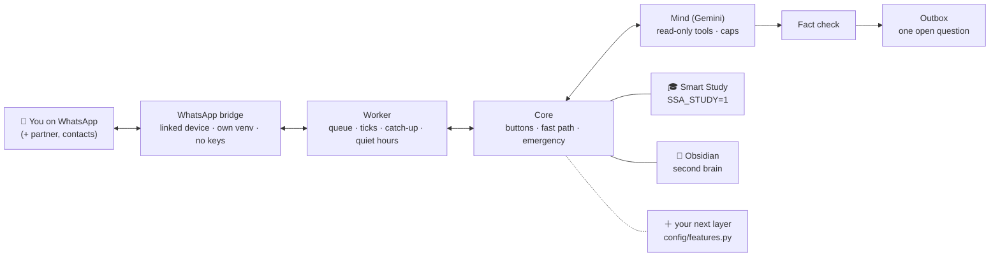

# 📲 Your personal assistant, in WhatsApp

*A personal assistant in WhatsApp: calendar, reminders that chase you, tasks and studies. It runs on your own server, and nothing goes out without your ✅.*

*העוזר האישי שלך בוואטסאפ — יומן, תזכורות שרודפות אחריך, משימות ולימודים. רץ על השרת שלך, ושום דבר לא יוצא בלי ✅ שלך.*

עברית: [README.he.md](README.he.md)

**A personal secretary that lives in WhatsApp, on your own number and your own server.** It manages your calendar, reminders and tasks with you, writes to people and books things for you, and remembers what matters to you. Nothing goes out without your ✅.

It is built in layers so it can grow with you: a secretary core, and "life domains" on top of it. The first and most developed layer is **Smart Study**, for university studies.

   

> [SETUP.md](SETUP.md) · [Features](docs/FEATURES.md) · [Architecture](docs/ARCHITECTURE.md) · [Costs](docs/COSTS.md) · [FAQ](docs/FAQ.md) · [SECURITY.md](SECURITY.md) · [CLAUDE.md](CLAUDE.md) — open this folder in Claude Code and say "help me set this up": it follows CLAUDE.md and walks you through, without ever touching your keys

## A day with it

An invented example, but this is what it looks like. The assistant talks Hebrew; the chat is shown as it appears, with English glosses in parentheses.

```text
07:45  🤖  ☀️ בוקר טוב! היום: 10:00 רופא שיניים, 18:30 אימון.
           📌 פתוח: להחזיר ספרים לספרייה (עד מחר).
           📝 מטלה 4 בהסתברות, הגשה ביום חמישי. עוד לא הוגשה.
           (Good morning! Today: 10:00 dentist, 18:30 workout. Open: return library
            books by tomorrow. Probability assignment 4 is due Thursday, not submitted.)

09:12  me  תוסיף ליומן חמישי ב-20 ארוחה אצל ההורים, ותזכיר לי ביום רביעי לקנות פרחים
           (Add to the calendar Thursday at 20:00 dinner at my parents', and remind me
            on Wednesday to buy flowers)
09:12  🤖  📅 חמישי 20:00–22:00 · ארוחה אצל ההורים
           ⏰ רביעי 18:00 · לקנות פרחים
           [✅ Add]  [✏️ Change]

11:30  me  [contact card: Example Hotel]  תיצור איתם קשר ותבטל את ההזמנה מחר
           (Contact them and cancel the booking for tomorrow)
11:30  🤖  מה מספר ההזמנה? בלי זה לא אוכל לבטל.
           (What is the booking number? I can't cancel without it.)
11:31  me  AB-77
11:31  🤖  זה מה שיישלח למלון לדוגמה:
           "שלום, כאן העוזר האישי של ישראל. נבקש לבטל את הזמנה AB-77 לתאריך מחר. תודה!"
           (This is what will be sent to Example Hotel: "Hello, this is Israel's personal
            assistant. Please cancel booking AB-77 for tomorrow's date. Thanks!")
           [✅ Send]  [✏️ Edit]  [❌ No]

14:05  🤖  🔔 תזכורת (🚨 חשוב): להתקשר לביטוח עד 15:00
           (Reminder (important): call the insurance company by 15:00)
14:20  🤖  🔔 שוב, כי סימנת שזה חשוב.  [✅ Seen]  [⏰ In an hour]
           (Again, because you marked it as important.)

16:40  🤖  📬 מהאוניברסיטה: התרגול שלך ביום שלישי עובר לחדר 305.
           (2 הודעות על קבוצות אחרות סיננתי.)
           (From the university: your Tuesday tutorial moves to room 305.
            I filtered out 2 messages about other groups.)

21:10  me  מה מחכה לי?   (What is waiting for me?)
21:10  🤖  ⏳ 1. מטלה 4 בהסתברות (חמישי)  2. להחזיר ספרים (מחר)
           3. המלון ענה? עוד אין תשובה, אבדוק שוב מחר ב-09:00.
           (1. Probability assignment 4 (Thursday) 2. Return books (tomorrow)
            3. Did the hotel answer? Not yet, I will check again tomorrow at 09:00.)
```

## What it does for you: three layers

### 1. The core: the secretary (always on)

| | |
|---|---|
| 📅 **Google Calendar** | "Add to the calendar...", "move the meeting to tomorrow", several events in one message. A calendar clash is shown before you approve |
| ⚡ **Instant answers, no model** | "What is my schedule tomorrow?", "what is waiting for me?", "when is the next deadline?" are answered from the data in under a second, for $0 |
| ⏰ **Reminders that do not give up** | "Remind me tomorrow morning..." is understood in code (Israel time). What you marked important and did not answer gets another message, then a calendar alert |
| ⏳ **Tasks, approvals, undo** | Everything that is open in one place. "I cancelled the hotel" closes the item. A ✅ you did not press is mentioned once. "Undo what you did" reverses the bot's last action |
| 🤝 **Messages, coordination and bookings** | "Tell mom that...", a contact card and then "contact them", signing up on a site in a real browser up to just before payment. All after ✅ |
| 📎 **Keeps your files** | A PDF, photo or link is saved with a summary and identifiers, so "what is the hotel booking number?" works weeks later |
| 🧳 **Thinks ahead** | A trip or a busy period in your calendar or a booking, and you get one plan: what to finish and by when, and what you will miss |
| 🌐 **Web questions, cheaply** | Weather, exchange rates, Shabbat times, news and opening hours in Python code, for $0. A general question: search and read, and one small model call with sources |
| 🔕 **Quiet when needed** | One open question at a time, quiet hours, a daily cap. "Stop sending me X" mutes it. When you were unavailable, everything waits for a single "what did I miss". It learns when you answer |
| 🛟 **Does not fall over** | Gemini is down or the budget is spent: emergency mode answers from the data. A nightly consistency check, an alert outside WhatsApp when the link drops, a weekly backup-restore test and a health page |
| 🛠️ **Improves itself** | 👍/👎 on answers and a weekly summary. A recurring task becomes a Python tool. Every fix passes all the tests and waits for your ✅ |

### 2. Study: Smart Study (`SSA_STUDY=1`)

Built and tested over a real semester at Tel Aviv University, which remains the example. Another university is configured in the `config/` files.

| | |
|---|---|
| ✅ **All obligations** | Every assignment and quiz from Moodle, per course: open, submitted, exams. An assignment mentioned in an email or a Moodle message is tracked within 15 minutes |
| 🪜 **Deadline ladder** | 7 days, 3, a day before, in the morning, 6 hours and 2 hours before, until you submit. If you want, every deadline is also in your calendar, updated automatically |
| 📊 **Grades and feedback** | The grade and the grader's comments in one message. A weakness profile only on request: "what should I focus on?" |
| 🎯 **Exam statistics** | The percentage of questions per topic and what recurs every year, from past exams, without a model |
| 🎥 **Lecture summaries** | The recordings of your group: captions first, then local transcription on the server ($0), and a paid service only as a last resort. A Hebrew summary including board reading, as a PDF by email and WhatsApp |
| 📓 **NotebookLM first** | A question about the material goes first to the course notebook, which automatically receives the transcripts and summaries |
| 📬 **Only your group** | Email and Moodle are filtered by your day, hour and teaching assistant. Room and time changes are included in every answer about the schedule |
| 🚶 **Campus walks** | Two back-to-back classes in distant buildings get one message a day |

### 3. Second brain: Obsidian (optional)

The assistant writes its own area in the vault: people, documents, what is open, this week, a daily journal and maps for each course and domain. The search (BM25 in Hebrew) runs over the notes you wrote yourself. Your notes are never overwritten or deleted (`rclone copy` only), and phone numbers, emails and identifiers are scrubbed from every note.

Every capability, how to turn it on and what it costs: [docs/FEATURES.md](docs/FEATURES.md). A message's route and the safety gates: [docs/ARCHITECTURE.md](docs/ARCHITECTURE.md).

## Built in layers

One secretary core, and life domains that you switch on with a flag. Each domain brings its own tools that the model may use, its periodic checks and its settings. A domain that is off is not loaded at all: the model does not see its tools, and the worker does not run its checks.



**Adding a layer of your own:** a flag in `config/features.py`, a module in `agent/`, its tools in `TOOLS` of `agent/mind.py` (they are filtered by `active_tools()`), and its periodic checks in `tick_list()` of `whatsapp/worker.py`. The study layer is built exactly this way, so you can copy from it.

## What it costs

Assistant only: roughly $3-10 a month. With studies: roughly $15-30. The numbers were measured on a real installation. Details and ways to save: [docs/COSTS.md](docs/COSTS.md).

| What | Cost |
|---|---|
| A message to the mind (Gemini) | $0.005-0.015 (cap of $0.10 per message, $1 per day) |
| A fast-path schedule question, reminders, buttons, undo, "what did I miss" | $0 |
| A web question | $0 built-in · ~$0.0005 general · ~$0.04 only as a fallback |
| A question about the system itself | under $0.01 (the same question on the same commit: $0) |
| A lecture summary: captions or local transcription / a paid transcription service | ~$0.08 / ~$0.40-0.50 |
| Pre-class primer · nightly site build | ~$0.001 · up to $0.10 |
| Grades, exam statistics, vault, backup, consistency check, emergency mode | $0 |
| Oracle Cloud Always Free server | $0 |
| A personal Gemini subscription instead of part of the API | **off by default**, `SSA_SUBSCRIPTION=1`. Explained in COSTS |

A hard monthly cap (default $50, configurable per month in `config/budget_caps.json`). Above it every paid call stops.

## Setup: two paths

| | Path | What you need |
|---|---|---|
| **A** | **The assistant only** (about an hour) | A Gemini key, an extra WhatsApp number for the bot (SIM/eSIM, linked device) that you write to from your own number, Google Calendar |
| **B** | **+ Smart Study** (optional, also later) | University login, `config/courses.yaml`, Moodle and Panopto, email, NotebookLM |

```bash
python -m venv venv && venv/bin/pip install -r requirements.txt   # Windows: venv\Scripts\pip
python scripts/setup_check.py --init       # .env from the template (SSA_STUDY=0)
python scripts/setup_check.py              # what is still missing on your path
python scripts/install_git_hooks.py        # every push runs the leak scan first
PYTHONIOENCODING=utf-8 python -m tests.test_assistant_only
```

Everything, step by step: [SETUP.md](SETUP.md). FAQ, the troubleshooting table and the variable dictionary: [docs/FAQ.md](docs/FAQ.md).

## ⚖️ Use responsibly

- The project is for **personal use** and is provided **as is, without any warranty**. Whatever you run, you run at your own risk.
- **WhatsApp:** the bridge uses an unofficial library (a linked device). This may not comply with WhatsApp's terms of use, and the number may be banned. A separate number is therefore recommended.
- **University:** use only your own accounts, and check that it is permitted under your institution's rules. The tool is not meant to bypass access, to share course materials with people who have no access to them, or to do anything in your place in exams and assignments where help is not allowed.
- **The language model** can be wrong. Check before you trust a date, an amount or a submission.
- **Privacy:** all the data stays with you, on your server. Do not upload `.env`, the login files or `data/` to GitHub.

## Security model

- **Nothing goes out without ✅:** a message to another person, a calendar event, a sign-up on a site. Words in the chat do not count as approval, only the button does.
- **Prompt-injection defense:** text from an email, a site, a document or another person is data, not a command. The model's tools only read. An action counts only if a separate check, which sees only your own messages, confirms that you asked for it. After reading an email, queries cannot be sent out in the same turn.
- **Only you (and whoever you approved):** every other number is silently rejected. The WhatsApp bridge runs in a separate environment, with no access to the keys.
- **Signing up on sites:** it never types a password, credit card, ID number or SMS code, and never clicks "pay". It hands the CAPTCHA back to you.
- **Hard cost cap:** default $50 a month, above which everything stops and a message arrives. There is also a daily cap on conversations.
- **On the server:** key-only SSH, fail2ban, a nightly security check without an LLM that alerts on every new failure, and a deploy gate that runs about 570 safety tests before every update.
- **No secrets in the code:** everything is in `.env` and in token files listed in `.gitignore`. Before every push `scripts/release_scan.py` runs (a local hook plus GitHub Actions), and every finding blocks.

Details in [SECURITY.md](SECURITY.md).

## Layout

| Folder | What |
|---|---|
| `agent/` | The brain: understanding messages, calendar, reminders, tasks, "what is waiting for me", coordination, memory, the improvement loop |
| `whatsapp/` | The bridge (linked device), the queue, the worker |
| `config/features.py` | Which layers are on |
| `integrations/` | Google Calendar, search. For studies: the university email, my.tau, the relevance filter |
| `collectors/` · `generators/` · `pipelines/` | Smart Study: Panopto, Moodle, summaries, NotebookLM, site |
| `deploy/` | systemd, crontab (`crontab.assistant.txt` for the assistant only), the deploy gate, hardening, git hooks |
| `tests/` | `test_safety_critical.py` (the gate), `conversation_evals.py`, `test_assistant_only.py` |
| `docs/FEATURES.md` · `docs/ARCHITECTURE.md` · `docs/COSTS.md` | Every capability and how to turn it on · a message's route and the safety gates · costs and how to save |
| `vault_sync/` | The second brain: the assistant's area in the vault, maps, search over your notes, privacy scrubbing |
| `docs/FAQ.md` | FAQ, the `setup_check` troubleshooting table, the `.env` variable dictionary, what the assistant can do |
| `docs/RUNBOOK.md` | Server operations: failures and how to fix them |
