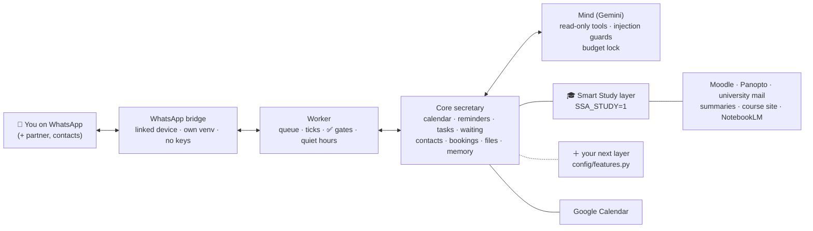

<div dir="rtl">

# 📲 העוזר האישי שלך, בוואטסאפ

> **העוזר האישי שלך בוואטסאפ — יומן, תזכורות שרודפות אחריך, משימות ולימודים. רץ על השרת שלך, ושום דבר לא יוצא בלי ✅ שלך.**

**מזכיר אישי שחי בוואטסאפ, על המספר שלך ועל השרת שלך.** הוא מנהל איתך את היומן, התזכורות והמשימות, כותב לאנשים ומזמין בשבילך, וזוכר מה חשוב לך. שום דבר לא יוצא בלי ✅ שלך.

הוא בנוי בשכבות, כדי לגדול איתך: ליבה של מזכיר, ועליה "תחומי חיים". השכבה הראשונה, והמפותחת ביותר, היא **Smart Study** ללימודים באוניברסיטה.

</div>

   

> **English below** · [SETUP.md](SETUP.md) · [SECURITY.md](SECURITY.md) · [CLAUDE.md](CLAUDE.md) — open this folder in Claude Code and say "help me set this up": it follows CLAUDE.md and walks you through, without ever touching your keys

<div dir="rtl">

## יום אחד איתו

דוגמה מומצאת, אבל ככה זה נראה:

</div>

```text
07:45  🤖  ☀️ בוקר טוב! היום: 10:00 רופא שיניים, 18:30 אימון.
           📌 פתוח: להחזיר ספרים לספרייה (עד מחר).
           📝 מטלה 4 בהסתברות, הגשה ביום חמישי. עוד לא הוגשה.

09:12  אני  תוסיף ליומן חמישי ב-20 ארוחה אצל ההורים, ותזכיר לי ביום רביעי לקנות פרחים
09:12  🤖  📅 חמישי 20:00–22:00 · ארוחה אצל ההורים
           ⏰ רביעי 18:00 · לקנות פרחים
           [✅ להוסיף]  [✏️ לשנות]

11:30  אני  [כרטיס איש קשר: מלון לדוגמה]  תיצור איתם קשר ותבטל את ההזמנה מחר
11:30  🤖  מה מספר ההזמנה? בלי זה לא אוכל לבטל.
11:31  אני  AB-77
11:31  🤖  זה מה שיישלח למלון לדוגמה:
           "שלום, כאן העוזר האישי של ישראל. נבקש לבטל את הזמנה AB-77 לתאריך מחר. תודה!"
           [✅ לשלוח]  [✏️ לערוך]  [❌ לא]

14:05  🤖  🔔 תזכורת (🚨 חשוב): להתקשר לביטוח עד 15:00
14:20  🤖  🔔 שוב, כי סימנת שזה חשוב.  [✅ ראיתי]  [⏰ עוד שעה]

16:40  🤖  📬 מהאוניברסיטה: התרגול שלך ביום שלישי עובר לחדר 305.
           (2 הודעות על קבוצות אחרות סיננתי.)

21:10  אני  מה מחכה לי?
21:10  🤖  ⏳ 1. מטלה 4 בהסתברות (חמישי)  2. להחזיר ספרים (מחר)
           3. המלון ענה? עוד אין תשובה, אבדוק שוב מחר ב-09:00.
```

<div dir="rtl">

## מה הוא עושה בשבילך

| | |
|---|---|
| 📅 **יומן גוגל** | "תוסיף ליומן…", "מה יש לי השבוע", "תזיז את הפגישה למחר". כמה אירועים בהודעה אחת, ותזכורת בצ'אט לפני אירוע |
| ⏰ **תזכורות שלא מוותרות** | "תזכיר לי מחר ב-9…", "כל יום ב-8…". מה שסימנת כחשוב ולא ענית עליו: עוד הודעה, ואחר כך התראה ביומן שמצלצלת גם כשוואטסאפ מושתק |
| ⏳ **משימות ו"מה מחכה לי"** | משימות עם תאריך שמזכירות בנימוס עד שסוגרים אותן. כל מה שפתוח במקום אחד. "ביטלתי את המלון" סוגר את הפריט בעצמו |
| 🤝 **הודעות, תיאומים והזמנות** | "תתאם עם יוסי פגישה", "שלח לאמא ש…", כרטיס איש קשר ואז "תיצור איתם קשר". הרשמה באתר עם קישור, בדפדפן אמיתי, עד לפני התשלום. אתה רואה מה ייצא ומאשר ב-✅ |
| 🔗 **קורא הכול** | קישורים, קבצים, צילומים, הקלטות קוליות: "מה הדדליין פה?", "תסכם לי" |
| 💑 **מצב בן/בת זוג** | מספר נוסף שמותר לו לדבר עם הבוט: הצעות ליומן, הודעות ביניכם, הכול באישור שלך |
| 🔔 **יוזם, במידה** | הודעת בוקר, ושכבה ש"שמה לב" (טיסה ביומן → רשימת אריזה). עד 3 ביום, לא בשעות השקט. "תפסיק לשאול על זה" משתיק נושא |
| 🧠 **זוכר** | "תזכור ש…": עובדות, החלטות, אנשי קשר. בערב הוא מציע מה ללמוד עליך, ושומר רק באישור |
| 🛠️ **משתפר מעצמו** | 👎 על תשובה, או "קלוד: …" עם בקשה לשינוי, נכנסים ללולאת שיפור לילית. כל תיקון עובר את כל הבדיקות, ונפרס רק אחרי ✅ |

## בנוי בשכבות

ליבה אחת של מזכיר, ותחומי חיים שנדלקים בדגל. כל תחום מביא איתו את הכלים שהמודל רשאי להשתמש בהם, את הבדיקות התקופתיות שלו ואת ההגדרות שלו. תחום כבוי לא נטען בכלל: המודל לא רואה את הכלים שלו, וה-worker לא מריץ את הבדיקות שלו.

</div>



<div dir="rtl">

**להוסיף שכבה משלך:** דגל ב-`config/features.py`, מודול ב-`agent/`, הכלים שלו ב-`TOOLS` של `agent/mind.py` (הם מסוננים ב-`active_tools()`), והבדיקות התקופתיות ב-`tick_list()` של `whatsapp/worker.py`. שכבת הלימודים בנויה בדיוק ככה, אז אפשר להעתיק ממנה.

## 🎓 Smart Study: השכבה הראשונה

נבנתה ונבדקה לאורך סמסטר אמיתי באוניברסיטת תל אביב, והיא החלק הכי מפותח במערכת. מדליקים אותה ב-`SSA_STUDY=1`.

| | |
|---|---|
| ✅ **מעקב חובות** | כל מטלה, בוחן ושיעורי בית ממודל, לפי קורס, עם המועד המדויק ומה כבר הוגש. "מה חסר לי?", "עשיתי את כל הבחנים?". התזכורות יודעות אם כבר הגשת |
| 📝 **בחנים ותרגילים** | מה טעית בבחנים שסיימת, עם התשובה שלך והנכונה. "יצא פתרון לתרגיל 3?". תרגילים שעלו לאתר המרצה מגיעים כשאלה אחת: להוסיף את ההגשה ליומן? |
| 📬 **עדכונים רק לקבוצה שלך** | מייל האוניברסיטה והודעות מודל מסוננים לפי היום, השעה והמתרגל **שלך**. הודעה על קבוצה אחרת לא מגיעה, ומה שלא ברור מסומן "❓ לא בטוח שזה נוגע לך" |
| 🎥 **סיכומי שיעורים** | ההקלטות של הקבוצה שלך מפנופטו, ואז כתוביות או תמלול, וסיכום בעברית עם Gemini כולל קריאת הלוח בקורסים מתמטיים. PDF למייל ולוואטסאפ |
| 🌐 **אתר קורסים** | כל הסיכומים, החומרים והמטלות לפי נושאים, עם הורדה של קורס שלם |
| 📓 **NotebookLM** | מחברת לכל קורס שמתעדכנת לבד. הבוט שואל אותה כשאתה שואל על החומר |
| 🗓️ **מבחנים ומערכת שעות** | שעות וחדרי מבחנים מ-my.tau, שינויי חדר ושעה מול היומן, הכנה קצרה לפני שיעור |
| 🧩 **חזרות, רק כשמבקשים** | "בחן אותי", "תן לי תרגילים ב…", תוכנית חזרה לפני מבחן מתוך מה שחוזר במבחנים קודמים |

## הקמה: שני מסלולים

| | מסלול | מה צריך |
|---|---|---|
| **א׳** | **רק העוזר** (בערך שעה) | מפתח Gemini, וואטסאפ עם המספר שלך (מכשיר מקושר), יומן גוגל |
| **ב׳** | **+ Smart Study** (רשות, גם אחר כך) | התחברות לאוניברסיטה, `config/courses.yaml`, מודל ופנופטו, מייל, NotebookLM |

</div>

```bash
python -m venv venv && venv/bin/pip install -r requirements.txt   # Windows: venv\Scripts\pip
python scripts/setup_check.py --init       # .env from the template (SSA_STUDY=0)
python scripts/setup_check.py              # what is still missing on your path
python scripts/install_git_hooks.py        # every push runs the leak scan first
PYTHONIOENCODING=utf-8 python -m tests.test_assistant_only
```

<div dir="rtl">

הכול, צעד אחרי צעד: [SETUP.md](SETUP.md).

## ⚖️ שימוש אחראי

- הפרויקט **לשימוש אישי** ומסופק **כמות שהוא, בלי שום אחריות**. כל מה שתריץ, אתה מריץ על אחריותך.
- **וואטסאפ:** הגשר משתמש בספרייה לא רשמית (מכשיר מקושר). זה עלול לא להתאים לתנאי השימוש של וואטסאפ, והמספר עלול להיחסם. לכן מומלץ מספר נפרד.
- **אוניברסיטה:** השתמש רק בחשבונות שלך, ובדוק שזה מותר לפי הכללים של המוסד שלך. הכלי לא נועד לעקוף גישה, לחלוק חומרי קורס עם מי שאין לו גישה אליהם, או לעשות משהו במקומך בבחינות ובמטלות שאסור לעזור בהן.
- **מודל השפה** יכול לטעות. בדוק לפני שאתה סומך על תאריך, סכום או הגשה.
- **פרטיות:** כל המידע נשאר אצלך, על השרת שלך. אל תעלה לגיטהאב את `.env`, את קבצי ההתחברות או את `data/`.

## מודל האבטחה

- **שום דבר לא יוצא בלי ✅:** הודעה לאדם אחר, אירוע ביומן, הרשמה באתר. מילים בצ'אט לא נחשבות אישור, רק הכפתור.
- **הגנה מהזרקת הוראות:** טקסט ממייל, מאתר, ממסמך או מאדם אחר הוא מידע, לא פקודה. הכלים של המודל רק קוראים. פעולה נחשבת רק אם בדיקה נפרדת, שרואה רק את ההודעות שלך, מאשרת שביקשת אותה. אחרי קריאת מייל אי אפשר לשלוח שאילתות החוצה באותו תור.
- **רק אתה (ומי שאישרת):** כל מספר אחר נדחה בשקט. הגשר לוואטסאפ רץ בסביבה נפרדת, בלי גישה למפתחות.
- **הרשמה באתרים:** אף פעם לא מקליד סיסמה, אשראי, ת"ז או קוד SMS, ולא לוחץ "לתשלום". את ה-CAPTCHA מחזיר אליך.
- **תקרת עלות קשיחה:** ברירת מחדל ‎$50 בחודש, ומעליה הכול נעצר ומגיעה הודעה. יש גם תקרה יומית לשיחות.
- **בשרת:** SSH במפתח בלבד, fail2ban, בדיקת אבטחה לילית בלי LLM שמתריעה על כל כשל חדש, ושער פריסה שמריץ כ-470 בדיקות לפני כל עדכון.
- **אין סודות בקוד:** הכול ב-`.env` ובקבצי טוקן שב-`.gitignore`. לפני כל push רץ `scripts/release_scan.py` (hook מקומי + GitHub Actions), וכל ממצא חוסם.

פירוט ב-[SECURITY.md](SECURITY.md).

## כמה זה עולה

| מה | בערך |
|---|---|
| העוזר, בשימוש יומיומי (Gemini) | עשרות סנטים עד דולר בחודש |
| שרת Oracle Cloud Always Free | ‎$0 |
| Smart Study: שיעור עם כתוביות / בלי | ‎$0.08 / ‎$0.40–0.50 |

## מבנה

| תיקייה | מה |
|---|---|
| `agent/` | המוח: הבנת הודעות, יומן, תזכורות, משימות, "מה מחכה לי", תיאומים, זיכרון, לולאת השיפור |
| `whatsapp/` | הגשר (מכשיר מקושר), התור, ה-worker |
| `config/features.py` | אילו שכבות דולקות |
| `integrations/` | יומן גוגל, חיפוש. ללימודים: מייל האוניברסיטה, my.tau, מסנן הרלוונטיות |
| `collectors/` · `generators/` · `pipelines/` | Smart Study: פנופטו, מודל, סיכומים, NotebookLM, אתר |
| `deploy/` | systemd, ‏crontab (`crontab.assistant.txt` לעוזר בלבד), שער הפריסה, הקשחה, git hooks |
| `tests/` | `test_safety_critical.py` (השער), `conversation_evals.py`, `test_assistant_only.py` |
| `docs/RUNBOOK.md` | תקלות נפוצות ואיך מתקנים |

</div>

---

## English

### Your personal assistant, in WhatsApp

**A self-hosted personal secretary that lives in WhatsApp, on your own number and your own server.** It runs your calendar, reminders and tasks, writes to people and books things for you, and remembers what matters to you. Nothing leaves without your ✅. The only LLM is Gemini.

It is built in **layers** so it can grow with you: one core secretary, plus life domains you switch on. The first and most developed layer is **Smart Study**, for university students.

### What it does for you

- **Google Calendar** in plain language, several events per message, a heads-up in the chat before each event.
- **Reminders that follow up:** when you marked something important and didn't react, a second message, then a calendar alarm that rings through a muted WhatsApp.
- **Tasks and "what's waiting for me":** open items in one place. Telling it "I cancelled the hotel" closes the item.
- **Messages, coordination, bookings:** drafted for you and sent only after your ✅. Web sign-ups run in a real browser up to payment, and it never types passwords or card details.
- **Reads everything you send:** links, files, photos, voice notes.
- **Partner mode, proactive notes with a daily cap** (quiet hours, per-topic mutes), **memory you approve**, and a **nightly self-improvement loop** whose fixes pass the full test suite and still wait for your ✅.

### Built in layers

A layer is a flag in `config/features.py`, a module in `agent/`, its tools in `agent/mind.py` `TOOLS` (filtered by `active_tools()`) and its periodic ticks in `whatsapp/worker.py` `tick_list()`. When a layer is off, the model is not shown its tools and the worker does not run its ticks. Smart Study is built exactly this way, so it is the template for yours.

### 🎓 Smart Study, the first layer (`SSA_STUDY=1`)

Built and tested over a real semester at Tel Aviv University.

- **Obligations tracker:** every Moodle assignment, quiz and homework per course, with exact deadlines and what is already submitted. Reminders know when you've handed something in.
- **Quizzes and homework:** your mistakes in finished quizzes, "is the solution out?", and exercises posted on a lecturer's site become one "add to calendar?" question.
- **University updates for your groups only:** university mail and Moodle posts are filtered by your day, hour and tutor. Anything unclear is flagged "❓ not sure this is yours".
- **Lecture summaries:** your group's Panopto recordings go through captions or transcription into a Hebrew Gemini summary (including reading the whiteboard) and arrive as a PDF by e-mail and WhatsApp.
- **Course site, NotebookLM per course, exam times and rooms from my.tau, pre-class primers**, and review sessions only when you ask for them.

### Setup

Two paths in [SETUP.md](SETUP.md) (Hebrew). **Path 1, assistant only**, needs a Gemini key, your WhatsApp number (linked device) and Google Calendar. **Path 2** adds Smart Study. `python scripts/setup_check.py` tells you what is missing, and `python -m tests.test_assistant_only` checks the minimal install.

### ⚖️ Use responsibly

- Personal use, provided **as is, without warranty**; you run it at your own risk.
- **WhatsApp:** the bridge uses an unofficial library (a linked device). That may conflict with WhatsApp's terms and the number can be banned. Use a separate number.
- **University:** use your own accounts only and check your institution's rules. It is not meant to bypass access, to share course material with people who do not have access, or to do work for you where outside help is not allowed.
- The language model can be wrong: verify dates, amounts and submissions before relying on them.
- **Privacy:** your data stays on your own server. Never commit `.env`, sign-in files or `data/`.

### Security model

- **✅ gates** on every outward action. Words never confirm a button.
- **Prompt-injection guards:** text from mail, the web or other people is data. The model's tools only read, and an action stands only if a separate check that sees nothing but your own messages says you asked for it.
- **Allow-listed numbers only.** The WhatsApp bridge runs in its own venv without the keys.
- **A hard monthly budget lock**, a nightly LLM-free security check, and a deploy gate of about 470 tests.
- **No secrets in the repo.** Keys and tokens live in `.env` and gitignored token files. `scripts/release_scan.py` runs before every push (a local pre-push hook plus GitHub Actions), and any finding blocks the push.
