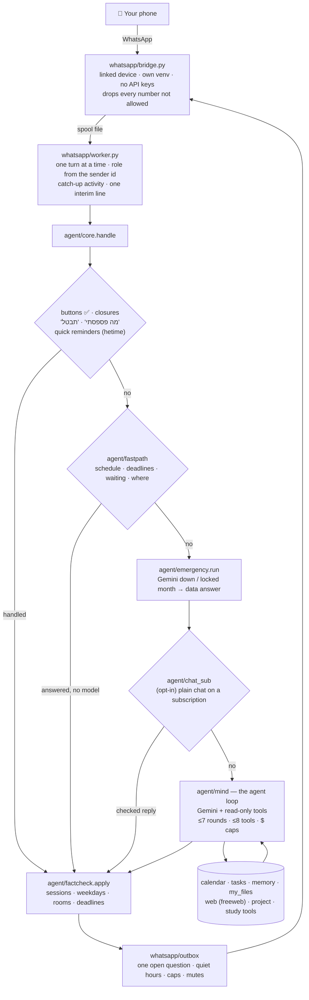
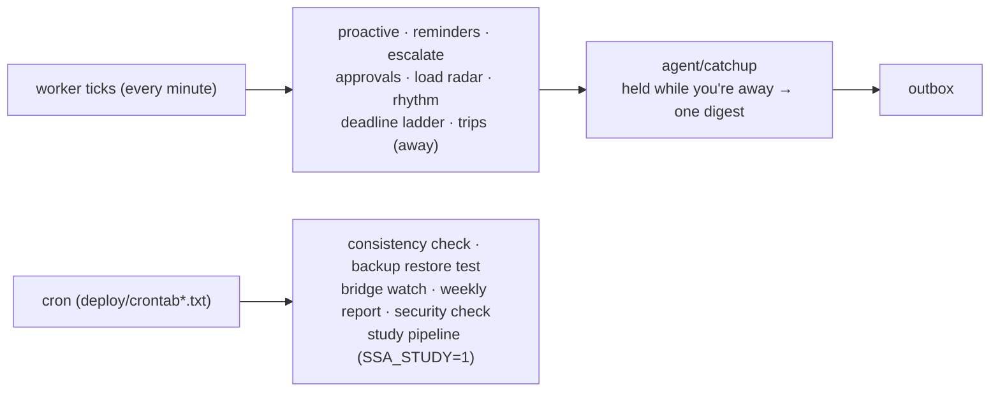

# Architecture — how one message travels, and the gates on the way

> הודעה שלך בוואטסאפ עוברת מסלול קבוע: קודם כל מה שאפשר לענות בקוד (בלי מודל), רק אחר כך המוח (Gemini עם כלים שרק קוראים), ואז בודק עובדות לפני שהתשובה יוצאת. כל פעולה כלפי חוץ מחכה לכפתור ✅ שלך.

## The flow

Background work runs beside it, never inside your turn:

### Step by step

1. **Bridge** (`whatsapp/bridge.py`). A linked WhatsApp device, in its own virtualenv with no API keys. It decides who is talking from the sender id only (never a name, never the words). Anything not from an allowed number is dropped before a file is written. A group message gets through only with your real tag in a group you turned on.
2. **Worker** (`whatsapp/worker.py`). Reads the spool, marks you active (for the catch-up), and opens one *interim* slot, so a slow turn says "רגע, בודק…" at most once (`agent/interim.py`).
3. **Deterministic handlers first** (`agent/core.py`). Button payloads (✅, undo `jund:`), closures in your words ("ביטלתי"), "מה פספסתי" (`agent/catchup.py`), "תבטל את מה שעשית" (`agent/journal.py`), reminders whose time `agent/hetime.py` fully understands. No model.
4. **Fast path** (`agent/fastpath.py`). A whole short schedule question is answered from the stores (calendar, timetable with the university's changes, obligations). No model, under a second.
5. **Emergency wrapper** (`agent/emergency.py`, `utils/llm_health.py`). If Gemini is out or the month is locked, the rest of the turn runs with every model call failing at once, and you get the closest data answer plus one honest line.
6. **Subscription chat** (`agent/chat_sub.py`, opt-in). A strict allow-list of harmless shapes (a greeting, "תנסח לי…") may go to a personal subscription. It sees only your own recent words. Its reply must pass a check, or the API answers.
7. **The mind** (`agent/mind.py`). Gemini with **read-only** tools. The only way out is `finish`; core turns a proposed action into a ✅ card. Static prompt blocks come first so the prefix is cacheable (cheaper input); the clock, open questions and the conversation come after. Caps: 7 rounds, 8 tools, `SSA_BRAIN_MAX_COST` a message, `SSA_BRAIN_DAY_CAP` a day, and 3 calls of the same tool at most.
8. **Fact check** (`agent/factcheck.py`). Before anything goes out, the answer's sessions, weekdays, rooms, hours and deadlines are compared with the data. It fixes or flags. It never drops an answer.
9. **Outbox** (`whatsapp/outbox.py`). One open numbered question at a time (the newest owns the digits; a quoted reply binds to its own; "which one?" when unsure; stale digits bind nothing). Quiet hours, the daily cap on proactive messages, muted kinds. Everything sent is logged.

## The safety gates

| Gate | Where | What it guarantees | Test |
|---|---|---|---|
| **✅ before anything outward** | `agent/core.py` (cards), `agent/assistant.py` | A message to someone else, a booking, a calendar change, a sign-up: only after your button. Words never confirm. The web agent stops before payment. | `tests/test_safety_critical.py` (many) |
| **Only the owner is obeyed** | `whatsapp/bridge.py`, roles in the worker | `WA_OWNER` gives orders; partner / friends / contacts have fewer rights; strangers are dropped. Owner-only tools (`project`, `my_files`) refuse any other chat. | bridge and role tests |
| **Third-party text is data** | `utils/gemini_sub.api_only`, `agent/group_mode.untrusted`, the injection guards | Mail, groups, forwarded messages, web pages and files go in random-delimiter blocks, only to the paid API (never to an agent-like subscription), and after reading mail a turn can't send anything out (`ALSO_TOOLS`). | injection tests, `test_freeweb_answer_treats_pages_as_data_19_11` |
| **Claims guard** | `agent/mind.claims` | "I sent / I added / I'll remind you" is removed unless it really happened in this turn. | claim tests |
| **Fetch only public addresses** | `integrations/freeweb.get`, `agent/secretary.fetch` | A search result or a redirect can't make the bot reach localhost, the private network or a non-http scheme. | `test_freeweb_fetch_never_reaches_inside_the_house_19_11` |
| **Budget lock** | `utils/budget.py`, `scripts/budget_check.py` | Above the month's cap every paid call stops (`data/budget_lock.json`); the lock clears itself on the 1st. Per-month caps in `config/budget_caps.json`. | budget tests |
| **Closed stays closed** | `agent/closure.py` | An item you closed never comes back as a reminder; the consistency check deactivates stragglers. | closure tests |
| **Gemini only** | the whole repo | No other LLM provider is imported; a test fails the build if one appears. | `test_no_anthropic_import` and friends |
| **Deploy gate** | `deploy/hooks/pre-receive` | A push to the server runs the safety tests and is rejected on any failure. | — |
| **Release scan** | `scripts/release_scan.py`, pre-push hook, GitHub Action | No key, token, phone, e-mail, address or ID shape can be pushed. | the scan itself |

## Where things live

| Area | Modules |
|---|---|
| Turn routing | `agent/core.py`, `agent/fastpath.py`, `agent/mind.py`, `agent/chat_sub.py`, `agent/emergency.py`, `agent/interim.py` |
| Truth checks | `agent/factcheck.py`, `agent/schedule.py` (the timetable with university changes), `agent/hetime.py` |
| Secretary | `agent/life.py` (reminders, memory), `agent/tasks.py`, `agent/open_items.py`, `agent/closure.py`, `agent/escalate.py`, `agent/approvals.py`, `agent/journal.py`, `agent/catchup.py`, `agent/load_radar.py`, `agent/rhythm.py`, `agent/noise.py`, `agent/proactive.py`, `agent/weekly_personal.py`, `agent/my_files.py`, `agent/away.py` (thinking ahead before a trip), `agent/domains/` |
| Reliability | `utils/llm_health.py`, `agent/consistency.py` + `scripts/consistency_check.py`, `scripts/wa_bridge_watch.py`, `scripts/backup_restore_test.py`, `utils/system_health.py` + `dashboard/views/system.py`, `utils/latency.py` |
| Web | `integrations/freeweb.py` (Python first), `integrations/websearch.py` (the grounded fallback) |
| About itself | `agent/project_qa.py`, `scripts/pc/projects_digest.py` (optional) |
| Self-improvement | `agent/improve.py`, `docs/SELF_IMPROVE.md`, `docs/SKILLS.md` |
| Study domain | `agent/obligations.py`, `agent/obligation_ingest.py`, `agent/deadline_ladder.py`, `agent/deadline_cal.py`, `collectors/local_asr.py`, `agent/grades.py`, `agent/exam_plan.py`, `agent/course_lookup.py`, `agent/nlm_ask.py`, `agent/campus.py`, `generators/nlm_lectures.py`, `collectors/`, `pipelines/`, `generators/` |
| Second brain | `vault_sync/assistant_export.py`, `vault_sync/maps.py`, `vault_sync/personal_index.py`, `vault_sync/mine.py`, `vault_sync/notewriter.py`, `vault_sync/privacy.py`, `scripts/vault_assistant.py` |
